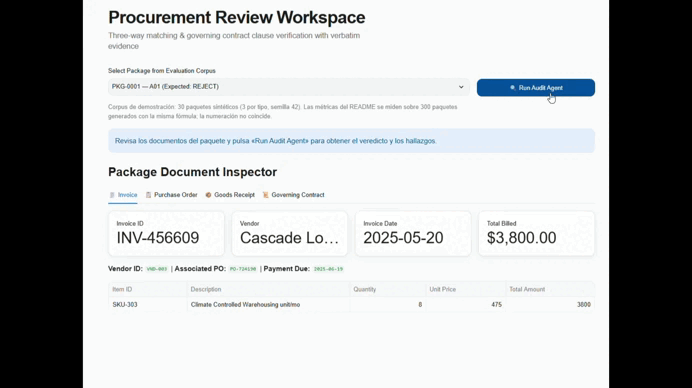
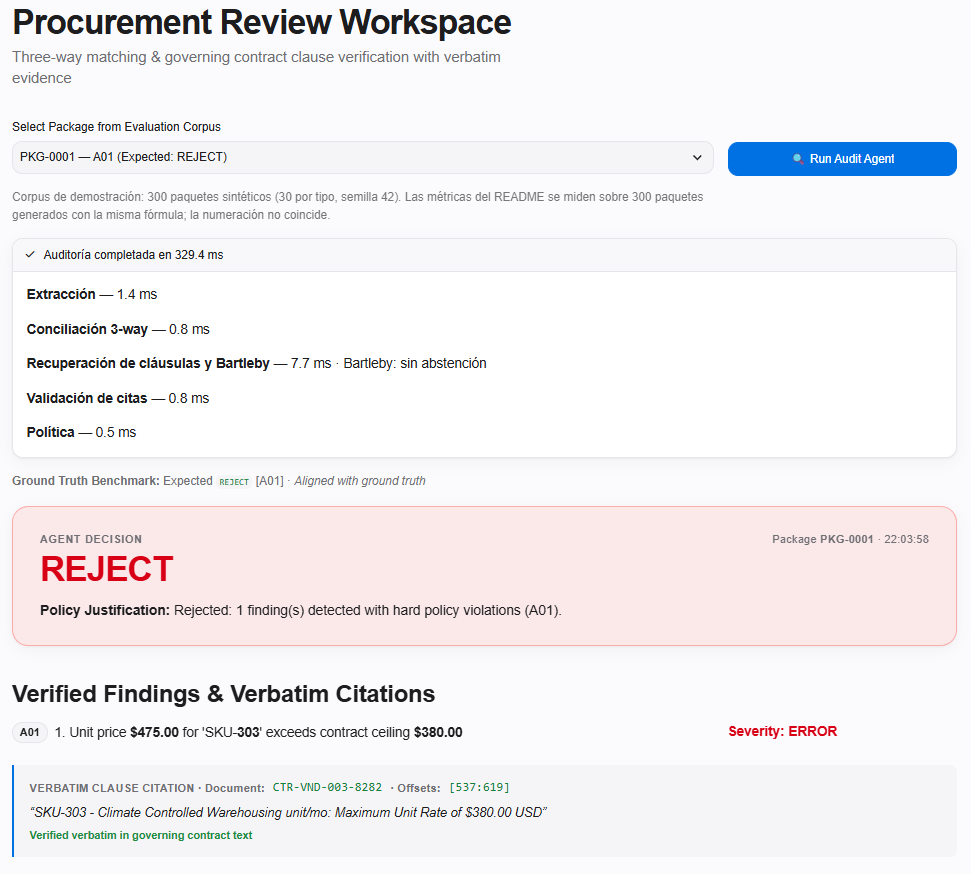
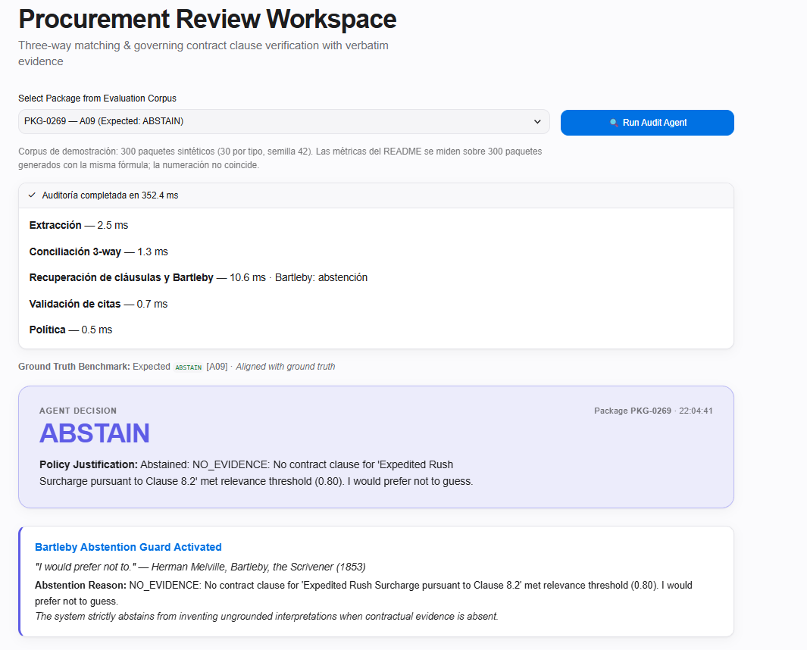
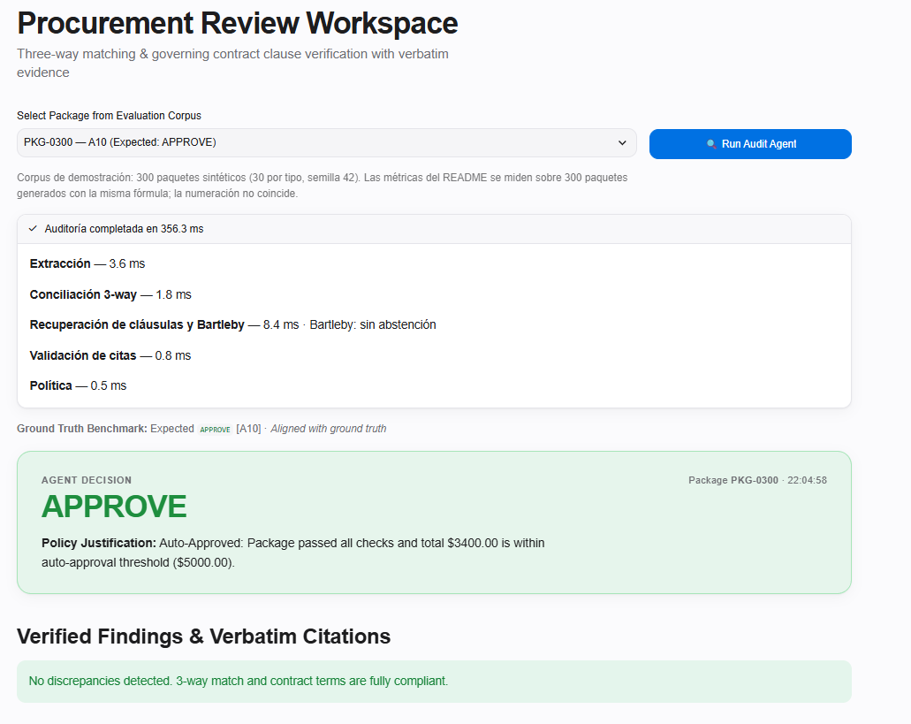
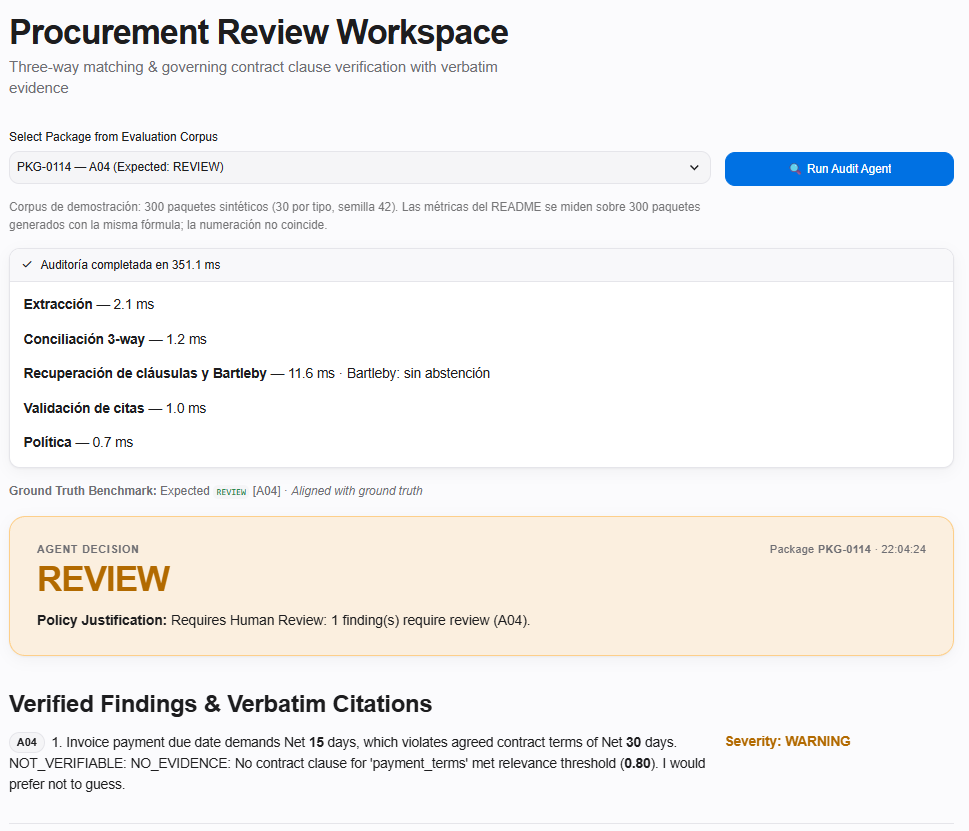
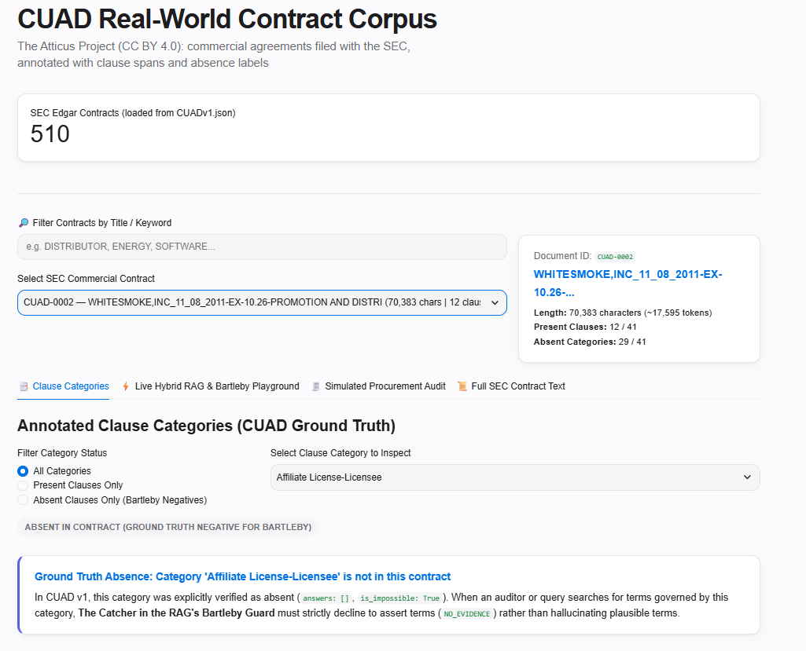
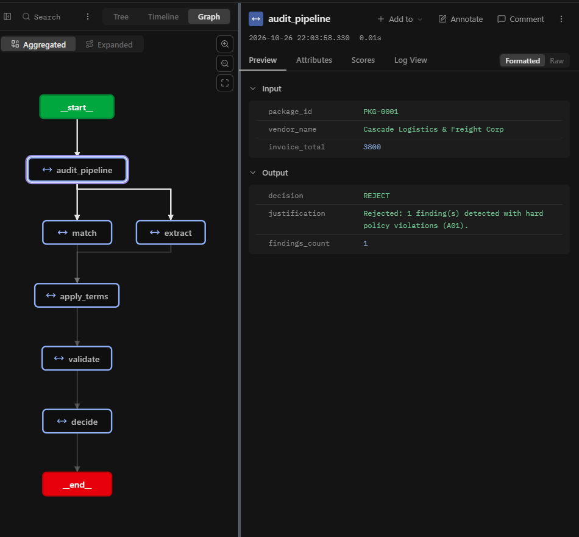
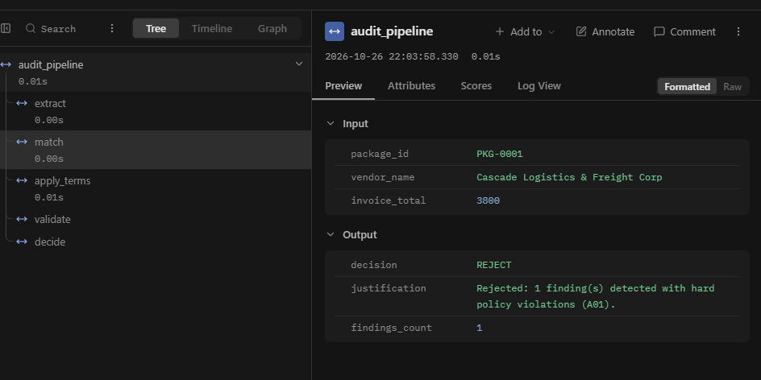
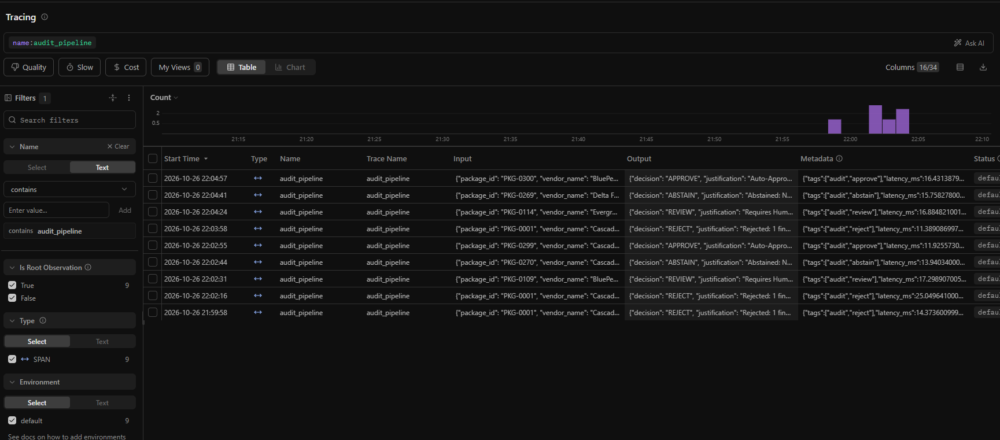

# The Catcher in the RAG

**Catches the invoice before it falls off the cliff.**

[](https://github.com/alexxcode/the-catcher-in-the-rag/actions/workflows/ci.yml)
[-0071E3)](https://catcher-ui-staging-hrok623gcq-uc.a.run.app)



## The idea

In Salinger's novel, Holden pictures himself standing at the edge of a cliff beside a rye field, catching the kids before they run over. This project takes the same post in accounts payable: it stands between the invoice and the payment and catches the ones about to go over the edge — a unit price above the contracted rate, a duplicate, a quantity that was billed but never received.

It follows three rules of conduct:

1. **Check everything against the contract.** A three-way match (purchase order, goods receipt, invoice) plus contract clauses retrieved with RAG.
2. **Cite or stay quiet.** Every clause-backed finding carries a verbatim excerpt that is validated as an exact substring of the contract, with character offsets. If the quote isn't in the source, the finding is dropped.
3. **When there is no evidence, prefer not to.** Bartleby, the abstention guard, is named after Melville's scrivener and his "I would prefer not to" (public domain). No relevant clause, no verdict: the package goes to a human.

| Caught: a price over the contract ceiling | Declined: no clause supports the charge |
|:---:|:---:|
|  |  |

## Four possible verdicts

| APPROVE | REVIEW | REJECT | ABSTAIN |
|:---:|:---:|:---:|:---:|
|  |  |  |  |
| Every check passed and the total is within the auto-approval limit. Pay it. | Something needs a person: a soft finding, or one the contract could not confirm. | A hard violation backed by a verbatim clause. Don't pay it. | No clause is relevant enough to judge. Bartleby declines to guess and hands it to a human. |

## How it works

The pipeline is a LangGraph state machine (`src/catcher_in_the_rag/graph.py`). The nodes run in this order:


- **extract** turns the package into typed documents and pulls the governing terms out of the contract text.
- **match** runs the deterministic three-way match.
- **apply_terms** retrieves the relevant clauses and passes them through Bartleby before any clause-backed finding is produced.
- **validate** drops any finding whose citation is not an exact substring of the contract.
- **decide** applies the policy rules and returns one of the four verdicts.

## The RAG, in plain words

The contract is split into clauses. For each question the audit needs to answer ("what is the price ceiling for this SKU?"), clauses are ranked by a hybrid retriever: BM25 for exact words and dense embeddings (`text-embedding-005` on Vertex AI) for meaning. The top passages go through Bartleby before anything is generated: if none is relevant enough, the answer is an abstention, not a guess. When a finding does cite a clause, its offsets point to the exact characters in the source text, so anyone can check the quote.

By default everything runs offline with deterministic stubs (`MAX_LIVE_CALLS=0`): no network calls, the same answer every time. Vertex AI and Gemini are opt-in, and every live call counts against a hard cap.



## Observability (Langfuse)



Each audit produces one trace: an `audit_pipeline` span with one child span per graph node, timed as the node actually runs. The span metadata carries the decision, the findings count and τ. In the Graph view, Langfuse draws `extract` and `match` side by side because they are sibling spans; in `graph.py` they run one after the other.

Tracing is optional and switches on when `LANGFUSE_PUBLIC_KEY` and `LANGFUSE_SECRET_KEY` are set; without them the tracer is a no-op. The screenshots come from local runs in stub mode. The deployed demo runs without traces.





## Results

Every number below lives in a `GEN` block regenerated from `evals/reports/*.json` (`make sync-readme-tables`). Nothing is typed by hand.

### 1. Out-of-sample retrieval
`MAX_LIVE_CALLS=20 uv run python evals/eval_out_of_sample.py --retrieval-ablation --embedding-provider vertex_ai --start 15 --end 50` → `evals/reports/retrieval_ablation_oos_report.json`

Dense retrieval does the heavy lifting: BM25 alone trails, and the hybrid is indistinguishable from dense on this sample.

<!-- GEN:retrieval_table -->
156 casos de presencia, CUAD-0016 to CUAD-0050 (35 contracts), embeddings `text-embedding-005`, commit `8a68fe2`. Empates resueltos por orden de aparición en el contrato.

| Método | Hit@1 | Hit@5 |
|---|:---:|:---:|
| **BM25** | 30.1% (47/156) [IC95 23.5–37.7] | 68.6% (107/156) [IC95 60.9–75.3] |
| **Denso** | 55.8% (87/156) [IC95 47.9–63.3] | 85.9% (134/156) [IC95 79.6–90.5] |
| **Híbrido (50/50)** | 55.1% (86/156) [IC95 47.3–62.7] | 84.6% (132/156) [IC95 78.1–89.4] |

- Hit@1: el intervalo de Wilson de BM25 no se solapa con los demás; los tres métodos no son indistinguibles en esta muestra. Denso y Híbrido (50/50): indistinguibles en esta muestra.
- Hit@5: el intervalo de Wilson de BM25 no se solapa con los demás; los tres métodos no son indistinguibles en esta muestra. Denso y Híbrido (50/50): indistinguibles en esta muestra.
<!-- /GEN -->

### 2. Bartleby's abstention, out of sample
`MAX_LIVE_CALLS=3 uv run python evals/eval_out_of_sample.py --start 15 --end 50 --embedding-provider vertex_ai --llm-provider stub --tau <τ>`

A higher τ buys correct abstentions on absent clauses and pays for them with false abstentions on present ones. The LLM row is not directly comparable with the others (see the note).

<!-- GEN:oos_bartleby_table -->
| Configuración | $\tau$ | Embeddings | Abstención correcta (ausencias) | Falsa abstención (presencias) | Macro F1 | Reporte |
|---|:---:|---|:---:|:---:|:---:|---|
| Sin LLM, solo score | 0.50 | `vertex_ai` | 63/264 = 23.9% [IC95 19.1–29.4] | 8/156 = 5.1% [IC95 2.6–9.8] | 0.4811 | `out_of_sample_cuad_stub_tau0.50_report.json` |
| Sin LLM, solo score | 0.80 | `vertex_ai` | 221/264 = 83.7% [IC95 78.8–87.7] | 72/156 = 46.2% [IC95 38.5–54.0] | 0.6936 | `out_of_sample_cuad_stub_tau0.80_report.json` |
| Con verificación LLM (3b) | 0.50 (fijo en el eval) | `stub (valor por defecto del comando)` | 248/264 = 93.9% [IC95 90.4–96.2] | 74/156 = 47.4% [IC95 39.8–55.2] | 0.7460 | `out_of_sample_cuad_report.json` (git_dirty) |
| Siempre abstenerse (trivial) | — | — | 264/264 = 100.0% | 156/156 = 100.0% | 0.3860 | calculado de los conteos |
<!-- /GEN -->
<!-- GEN:operating_point -->
Sin LLM, $\tau$ = 0.80 (valor actual de `config/thresholds.yaml`) se abstiene en 83.7% de las ausencias (221/264) y en 46.2% de las presencias (72/156). $\tau$ = 0.50 casi nunca se abstiene: 71 de 420 consultas (16.9%), y solo en 23.9% de las ausencias.

> **Nota:** La fila con LLM no es comparable con las filas sin LLM: usó embeddings `stub` y se generó con `git_dirty: true`.
<!-- /GEN -->
<!-- GEN:mode3_diagnosis -->
> **Bartleby: tres afirmaciones medidas**
> (a) **El score de recuperación solo es una señal débil.** AUC-ROC de validación 0.5909 [IC95 0.3885–0.7933] con `text-embedding-005` (CUAD, contratos 1–15, `calibration_cuad_report.json`); el intervalo incluye 0.50.
>
> (b) **La verificación con LLM aporta la abstención.** Con los mismos embeddings y $\tau$ = 0.50 (`bartleby_llm_verification_report.json`), la abstención correcta en ausencias pasa de 22/79 (27.9%) sin LLM a 50/79 (63.3%) con LLM.
>
> (c) **Las falsas abstenciones siguen altas.** Con LLM, fuera de muestra: 74/156 = 47.4% [IC95 39.8–55.2] de las cláusulas presentes (`out_of_sample_cuad_report.json`). Cada falsa abstención es una revisión humana innecesaria: 74 en 420 consultas (17.6 por cada 100). Tiempo o costo por revisión: NOT MEASURED.
<!-- /GEN -->

### 3. LLM verification (mode 3)
`make eval-bartleby-llm` → `evals/reports/bartleby_llm_verification_report.json`

Measured with τ fixed in the eval and whatever embeddings that run's environment used (the report does not record them). LLM verification adds most of the correct abstentions, and false abstentions, latency and cost rise with it.

<!-- GEN:llm_verification_table -->
| Modo de Guardia | $\tau$ | Verificación LLM | Abstención Correcta (Recall) | Falsa Abstención (Error) | Macro F1 | Latencia Media | Costo Estimado / 1k* |
|---|:---:|:---:|:---:|:---:|:---:|:---:|:---:|
| **Pure Vector Hybrid (tau=0.50)** | **0.50** | `Desactivada` | **27.9% (22/79)** | **0.0% (0/26)** | **0.4564** | 17.1 ms | $0.0000 |
| **Pure Vector Hybrid (tau=0.70)** | **0.70** | `Desactivada` | **40.5% (32/79)** | **26.9% (7/26)** | **0.4777** | 16.9 ms | $0.0000 |
| **Bartleby Condition 3 (tau=0.50 + LLM Verification)** | **0.50** | `Gemini 3.5 Flash` | **63.3% (50/79)** | **42.3% (11/26)** | **0.5714** | 3303.5 ms | $2.3367 |
<!-- /GEN -->
<!-- GEN:llm_verification_footnote -->
*\*Costo estimado a partir de tokens medidos (98,140 prompt / 10,905 candidate, incluyendo tokens de pensamiento contabilizados como salida) y tarifas pay-as-you-go oficiales en Vertex AI ($1.50 / $9.00 por millón de tokens para Gemini 3.5 Flash según [`config/pricing.yaml`](config/pricing.yaml)). Con Gemini 3.8 Flash, el costo estimado resulta en ~$0.88/1k con la tarifa introductoria vigente ($0.75 / $3.75 hasta el 31 de diciembre de 2026) y en ~$1.77/1k con la tarifa estándar ($1.50 / $7.50 a partir del 1 de enero de 2027).*
<!-- /GEN -->

### 4. Calibrating τ
`MAX_LIVE_CALLS=80 uv run python -m evals.calibrate_cuad --embedding-provider vertex_ai` → `evals/reports/calibration_cuad_report.json`

On real contracts the retrieval score barely separates present clauses from absent ones: the validation interval includes chance.

<!-- GEN:domain_calibration_table -->
| Dominio Evaluado | Dataset de Origen | Umbral Calibrado ($\tau$) | Macro F1 Validación | AUC-ROC Separabilidad | Desempeño Empírico en Transferencia |
|---|---|:---:|:---:|:---:|---|
| **Plantillas Sintéticas (+ Heurística 3a*)** | Datagen M1 (300 paquetes; no es evidencia) | **0.50** | **1.0000** | **0.1204** | F1 con regex de denegación 3a: 1.0000. Score puro sin 3a: F1 0.4737 (abstención 0.0%). |
| **Contratos SEC Reales (Transfer)** | CUAD v1, contratos 1–15, Train/Val 60/40 | **0.50** (fijado) | **0.4496** | **0.5909** | Abstención correcta en ausencias 25.8% (74.2% pasan). |
| **Contratos SEC Reales (Recalibrado)** | CUAD v1, contratos 1–15, Train/Val 60/40 | **0.80** (recalibrado, no aplicado) | **0.5457** | **0.5909** | Abstención correcta 54.8%, falsas abstenciones 36.4% (Siempre Abstenerse: 0.4247). |
<!-- /GEN -->
<!-- GEN:domain_calibration_diagnosis -->
> **Diagnóstico de calibración en CUAD** (`evals/reports/calibration_cuad_report.json`)
> Sintético (referencia, no evidencia): $\tau = 0.50$, Macro F1 validación 1.0000, AUC-ROC 0.1204.
> CUAD: 15 contratos (entrenamiento 9, validación 6, semilla 42), embeddings `text-embedding-005`.
>
> 1. **AUC-ROC (Wilcoxon-Mann-Whitney):** entrenamiento 0.7708 [IC95 0.6202–0.9214]; validación 0.5909 [IC95 0.3885–0.7933]; el intervalo de validación incluye 0.50: no distinguible del azar en esta muestra.
> 2. **Umbral:** a $\tau = 0.50$ la abstención correcta en ausencias de validación es 25.8%. A $\tau = 0.80$ (óptimo de entrenamiento) es 54.8%, con 36.4% de falsas abstenciones y Macro F1 0.5457 (Siempre Abstenerse: 0.4247; diferencia +0.1210).
<!-- /GEN -->

### 5. Synthetic control — not evidence
`LLM_PROVIDER=stub EMBEDDING_PROVIDER=stub MAX_LIVE_CALLS=0 make eval-ablations` → `evals/reports/canonical_baseline_report.json`

Templates written by `datagen/`, measured with the τ in `config/thresholds.yaml`. It checks that the wiring works, nothing more.

<!-- GEN:synthetic_ablation_table -->
| Métrica de Evaluación | Con Términos Contractuales (Baseline) | Sin Términos (Solo Cotejo 3-Way) | Impacto / Delta |
|---|:---:|:---:|:---:|
| **Exactitud Global de Decisión** | **91.3%** (274/300) | **60.0%** (180/300) | **ablación: sin evaluador de cláusulas (+31.3% degradación)** |
| **Validez de Citas Verbatim** | **100.0%** (64/64) [plantillas sintéticas] | N/A | Cero citas sintéticas inválidas |
| **Abstención Correcta de Bartleby** | **100.0%** (30/30 en A09*) | 0.0% (0/30 en A09) | Detección de silencios (vía heurística de plantilla 3a*) |
| **Tasa de Falsos Positivos (A10)** | **0.0%** (0/30) | 0.0% (0/30) | Paquetes limpios aprobados sin fricción |
| **Recall@5 de Recuperación** | **100.0%** [plantillas sintéticas] | N/A | Recuperación en plantillas sintéticas |
| **Latencia Media por Paquete** | **16.9 ms** | 0.0 ms | Ejecución determinista local |
<!-- /GEN -->

## Honest limitations

- **Synthetic is not evidence.** The synthetic packages come from templates the generator wrote; section 5 only shows the wiring works.
- **Rule 3a is a template heuristic.** It was written against the synthetic templates, and the synthetic Bartleby scores lean on it.
- **Stub embeddings in part of the measurements.** The LLM row in section 2 used stub embeddings and was generated from a dirty tree; section 5 runs on stub embeddings; the section 3 report does not record which embeddings it used.
- **τ comes from CUAD.** `config/thresholds.yaml` uses the τ calibrated on CUAD (section 4). With that τ and stub embeddings, synthetic A06 packages move from REJECT to REVIEW (a NOT_VERIFIABLE finding); the synthetic tests pin the τ from their own calibration. Section 5 reflects that change.
- **False abstentions remain high.** Each one is an unnecessary human review (section 2).
- **The demo corpus is not the measured corpus.** The demo ships 30 synthetic packages (3 per type, seed 42) and 6 CUAD contracts. The metrics are measured on 300 packages from the same generator and on CUAD contracts 16–50 (τ calibrated on contracts 1–15). Package numbering does not match between the two. The screenshots come from local runs on the full corpora.
- **Reranker:** not measured, disabled.
- **NOT MEASURED:** LLM abstention with `text-embedding-005` out of sample, the cost of a human review, latency over a distributed network.

## Try it

**Live demo.** [Staging on Cloud Run](https://catcher-ui-staging-hrok623gcq-uc.a.run.app), in stub mode with no calls to Gemini. It scales to zero and may be switched off.

**Run it locally.**

```bash
uv sync
make run-api      # FastAPI on port 8000
make run-ui       # Streamlit on port 8501
make verify       # lint, tests, claim audit, report checks, terraform validate
```

**Deploy it (Cloud Run staging).**

1. Authenticate: `gcloud auth login && gcloud auth application-default login`.
2. Build, push and plan: `PROJECT_ID=<project> REGION=<region> scripts/deploy.sh`. It prints the service URL and the smoke command; it applies nothing.
3. Apply by hand after reading the plan: `terraform -chdir=infra/terraform apply tfplan`, then `scripts/smoke.sh <API_URL>`.

On the first deploy the Artifact Registry repository doesn't exist yet: run `terraform -chdir=infra/terraform apply -target=google_artifact_registry_repository.images -var container_image=none` first (the variable is required; that apply only creates the repository). With `MAX_LIVE_CALLS=0`, the Cloud Run default, the service runs on stubs only.

> **Don't run a bare `terraform apply`.** Use `scripts/deploy.sh`, then `apply tfplan`.

## Stack, datasets and licenses

- **Stack:** Python, LangGraph, Pydantic, FastAPI, Streamlit, rank-bm25, Vertex AI (Gemini, `text-embedding-005`), Langfuse, Terraform on Cloud Run, uv.
- **Data:** [CUAD v1](https://github.com/TheAtticusProject/cuad) by The Atticus Project, CC BY 4.0. `data/demo/cuad_demo.json` is an unmodified subset redistributed under the same license; the full corpus comes from `make download-data`. Synthetic packages are generated by `datagen/`.
- **License:** MIT (`pyproject.toml`). Third-party credits are in [ATTRIBUTION.md](ATTRIBUTION.md).

## About the names

*The Catcher in the RAG* is a parody of J.D. Salinger's *The Catcher in the Rye*: no text from the novel appears here, only the picture of someone standing at the edge so nobody falls. *Bartleby* is the clerk in Herman Melville's *Bartleby, the Scrivener* (1853), who answers every request with "I would prefer not to." The guard borrows his manners: when the contract says nothing, it says nothing either.
