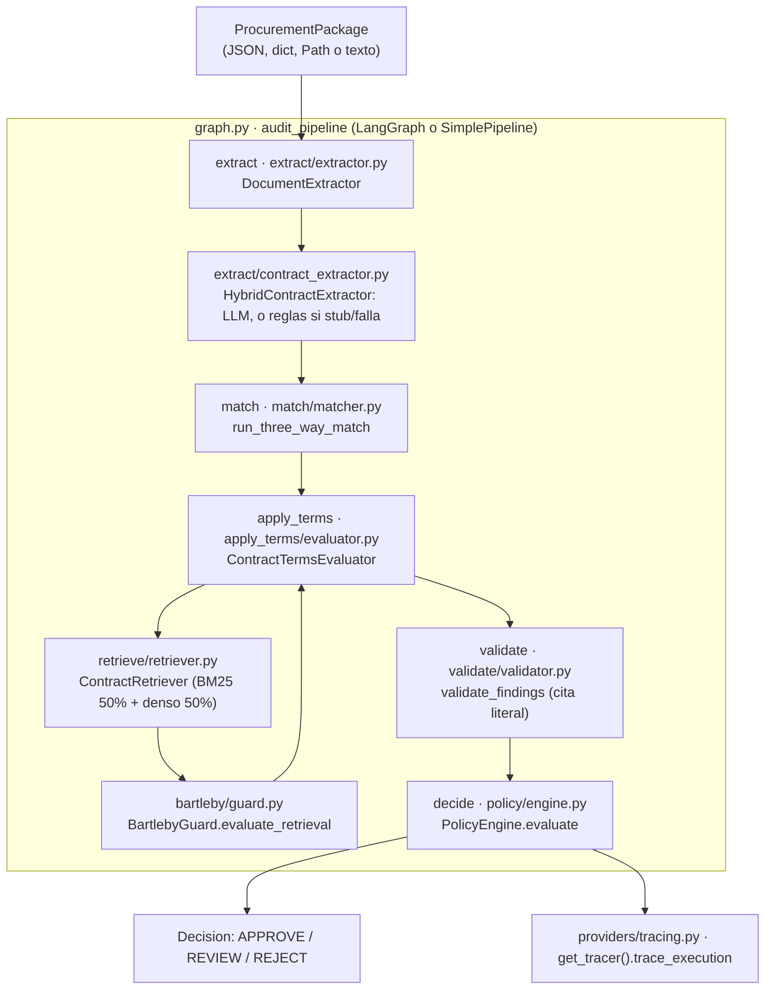

# Arquitectura actual (leída del código, 2026-10-25; sin llamadas en vivo, sin propuestas)

## 1. Flujo real: de la factura al veredicto

La entrada es un `ProcurementPackage` (contrato + orden de compra + recepción + factura).

## 2. Stub y Vertex

| Módulo | Qué usa por defecto | Cuándo usa Vertex |
|---|---|---|
| `providers/factory.py` | `LLM_PROVIDER` y `EMBEDDING_PROVIDER`; los dos valen `stub` si no están definidos | Con `vertex_ai`, `gemini`, `gcp` o `real` |
| `extract/contract_extractor.py` | Con stub, extracción por reglas (`RuleBasedContractExtractor`) | Con un LLM real llama a `GeminiProvider.extract_structured`; si falla, vuelve a las reglas |
| `retrieve/retriever.py` | `StubEmbeddingProvider` (vectores sacados de un hash) | Solo con `EMBEDDING_PROVIDER=vertex_ai` (`text-embedding-005` con caché) |
| `bartleby/guard.py` (condición 3b) | Con stub, o sin provider, aprueba sin llamar al LLM | Solo si quien llama le pasa `llm_provider` (los evals lo hacen; el grafo no) |
| `providers/gemini.py` | — | Hay llamadas en `extract_structured`, `generate_text`, `check_model_health` y en los embeddings. Todas pasan por `MAX_LIVE_CALLS`, que vale 0 por defecto y bloquea la llamada |
| `match/`, `validate/`, `policy/` | Deterministas; nunca llaman a un LLM | — |

- `.env` local no define `LLM_PROVIDER` ni `EMBEDDING_PROVIDER`: todo corre en stub.
- Las mediciones de CUAD usan embeddings stub: lo dice `measure_mode3_runs.py`, y `eval_bartleby_llm.py` también, salvo que el entorno diga otra cosa.

## 3. Responsabilidad cortada o duplicada

Estado tras los commits de esta ronda (puntos 1–10 de la versión anterior):

1. **Umbral de Bartleby (τ):** un solo cargador, `load_bartleby_thresholds(tau)` en `bartleby/guard.py`, lee τ y `min_evidence_spans` de `config/thresholds.yaml`. Lo usan `BartlebyGuard`, `eval_bartleby_llm.py`, `eval_out_of_sample.py` y `measure_mode3_runs.py`. Los tres evals aceptan `--tau` y lo escriben en el reporte como `tau_override`. El modo 2 de `eval_bartleby_llm.py` sigue fijando su τ propio por diseño. `calibrate_cuad.py` sigue solo informando.
2. **Bartleby en el grafo:** `ContractTermsEvaluator` recibe el `llm_provider` del pipeline y se lo pasa a `evaluate_retrieval`. Con un provider real, la condición 3b corre en el grafo.
3. **Abstenciones en A04, A05, A06:** si Bartleby se abstiene, se emite un hallazgo con `verification_status = NOT_VERIFIABLE`, sin cita y con el motivo. El validador lo conserva y la política lo manda a REVIEW. Si no se abstiene, la cita sigue saliendo de frases fijas buscadas con `find_span`, no de lo recuperado.
4. **A09:** ya no hay `return` temprano. Se revisan todas las líneas y los motivos de abstención se acumulan.
5. **Validación de citas:** solo en `validate/validator.py`. `BartlebyGuard.evaluate_finding` se borró.
6. **"Requiere revisión humana":** `extract` solo informa `llm_extraction_failed`; `PolicyEngine.evaluate(extraction_failed=...)` lo decide una vez. El `Decision` lleva `requires_human_review=True` y el motivo, y nunca es APPROVE.
7. **La UI recalcula por su cuenta:** sin cambios. `ui/app.py` crea su propio `ContractRetriever()` y `BartlebyGuard()` para la vista de RAG.
8. **Elección del provider:** una sola función, `resolve_llm_provider(credential)` en `providers/factory.py`, usada por la API y la UI. La UI solo manda el PIN si el auditor lo desbloqueó. Si `API_URL` falla, muestra "API no disponible: modo local/stub" y corre con stub; la barra lateral muestra el modo activo.
9. **Configuración sin uso:** se borraron `min_bm25_score`, `min_dense_score`, `top_k_to_llm`, `retrieval.*` y `eval.trace_sample_rate`.
10. **`repro_check.py`:** solo queda `evals/repro_check.py`. La copia ignorada se borró del disco.

## 4. Puntos de entrada y comandos locales

| Entrada | Archivo | Comando |
|---|---|---|
| API (FastAPI) | `src/catcher_in_the_rag/api/main.py` (`/api/audit`, `/health`, `/healthz`, `/api/reports`) | `make run-api` (uvicorn, puerto 8000) |
| UI (Streamlit) | `ui/app.py` | `make run-ui` (puerto 8501) |
| Las dos en Docker | `docker-compose.yml` | `docker compose up` |
| Evals del pipeline | `evals/run.py` | `make eval`, `eval-ablations`, `eval-extraction`, `eval-bakeoff`, `calibrate-bartleby`, `eval-cuad` |
| Eval de Bartleby con LLM | `evals/eval_bartleby_llm.py` | `make eval-bartleby-llm` |
| Calibración en CUAD | `evals/calibrate_cuad.py` | `make calibrate-cuad` |
| Fuera de muestra | `evals/eval_out_of_sample.py` | `uv run python evals/eval_out_of_sample.py --start .. --end ..` |
| Chequeo de reportes | `evals/repro_check.py` | `make repro-check`; `make verify` |
| Tests | `tests/` | `make test` (sin `real_llm`) |

## 5. Langfuse y Streamlit

**Langfuse:**
- `providers/tracing.py` usa `LangfuseTracer` solo si están definidas `LANGFUSE_PUBLIC_KEY` y `LANGFUSE_SECRET_KEY` (en `.env` local lo están); si no, `NoOpTracer`. Traza `graph.py` (una por auditoría) y `gemini.py` (una por generación); los embeddings no.
- `pyproject` pide `langfuse>=5`. Solo queda el camino `start_observation`; el camino `client.trace` se quitó.
- `trace_execution` devuelve el trace id del SDK y `audit_pipeline` lo guarda en `final_state["trace_id"]`. Una auditoría con stub y `LANGFUSE_*` definidas devolvió un trace id (está en el mensaje del commit de tracing).
- Si las trazas llegan de verdad al servidor: **NOT MEASURED**. Terraform define los secretos `langfuse-public-key` y `langfuse-secret-key`.

**Streamlit:**
- `ui/app.py` llama a la API si existe `API_URL`. Si la API falla, muestra un aviso visible y corre `audit_pipeline` local con stub. Sin `API_URL`, corre local con el provider que decide `resolve_llm_provider`.
- Lee los reportes directamente de `evals/reports/` (`cuad_benchmark_latest.json`, `bakeoff_latest.json`, etc.).
- Terraform define un servicio Cloud Run `catcher-ui-<env>` público, que invoca a la API privada.
- Si arranca y se ve bien hoy: **NOT MEASURED** (no lo levanté).
